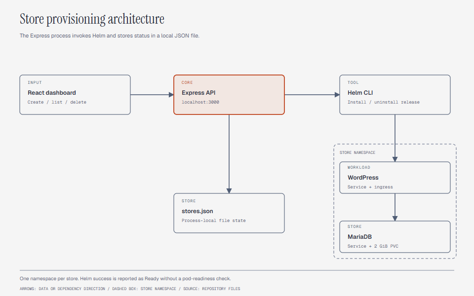

# Kubernetes Store Orchestrator

A prototype that provisions WordPress and MariaDB instances with Helm. An Express API manages releases, and React dashboards display store records.

## System design



The API creates a store identifier and writes it to `backend/stores.json`.
It then runs `helm install` with a namespace for that store.
The chart contains WordPress, MariaDB, services, an ingress, a database secret, and a 2 GiB volume claim.

`Ready` means the Helm command returned successfully. The backend does not wait for pod readiness.
WooCommerce is not installed by the chart. Install it through WordPress if you need commerce features.

## Repository map

| Path | Responsibility |
|---|---|
| [backend/index.js](backend/index.js) | Express routes and Helm commands |
| [backend/stores.json](backend/stores.json) | Local store records |
| [dashboard-react](dashboard-react/) | React interface with a Vanta background |
| [dashboard](dashboard/) | Earlier dashboard source |
| [helm/store-chart](helm/store-chart/) | Kubernetes resource templates |

## Current setup gaps

The checked-in application is not ready for the original one-command setup:

- `backend/package.json` is empty. The backend imports `express` and `uuid` and uses ES modules.
- `dashboard-react/` has no root `index.html` entry file for Vite.
- The React dashboard uses `http://localhost:3000`. The API does not configure CORS for a separate dashboard origin.
- The chart creates a Namespace while the backend also uses Helm's `--create-namespace`. Review ownership before installing.
- There is no separate production values file in this checkout.

Resolve these gaps before attempting an end-to-end deployment.

## Inspect the chart

Install Helm and kubectl. Use a disposable Kubernetes cluster with an ingress controller and a default storage class.
Check access and render the manifests without creating resources:

```sh
kubectl get nodes
helm lint helm/store-chart
helm template demo helm/store-chart --set storeName=demo --set domain=demo.localhost
```

The chart defaults to MariaDB 10.6 and WordPress with PHP 8.2 and Apache.
Replace the sample database passwords in your local values configuration before deployment.
Configure local hostname resolution and the ingress controller for `*.localhost` store domains.

## API contracts

| Method | Route | Behavior |
|---|---|---|
| GET | `/stores` | Read store records from JSON |
| POST | `/stores` | Create a record and start Helm installation |
| DELETE | `/stores/:id` | Start Helm uninstallation and namespace deletion |

The backend expects its working directory to be `backend/`.
It resolves both `stores.json` and `../helm/store-chart` relative to that directory.

Deleting a store deletes its record before the external commands finish.
The namespace deletion can delete the database volume claim. Storage reclaim policy determines the underlying volume's fate.

## Limits

State lives in one local JSON file. This implementation is not a stateless or horizontally synchronized service.
It has no authentication, durable job queue, request idempotency, or health-based status reconciliation.
The delete route passes the identifier into a shell command without validation. Keep this prototype off untrusted networks until the route checks identifiers.
WordPress uploads do not have a persistent volume in the supplied chart.

This documentation update does not provision a cluster or claim a successful deployment.

## License

[MIT](LICENSE) covers original source and documentation by Velan E.
Container images and npm packages retain their own licenses. See [LICENSING.md](LICENSING.md).
